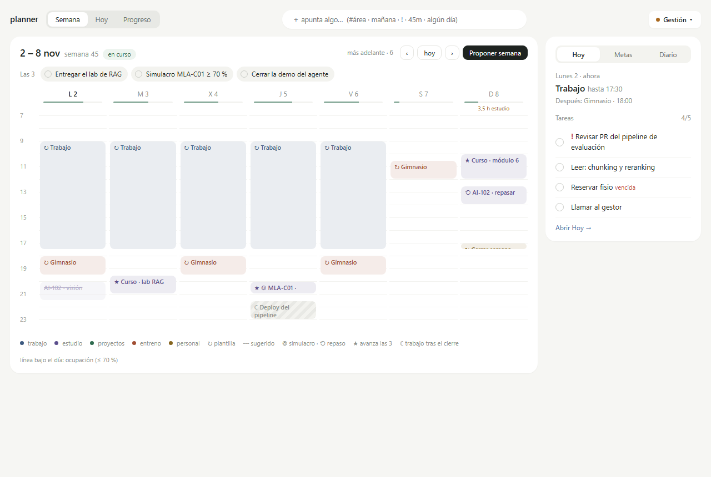
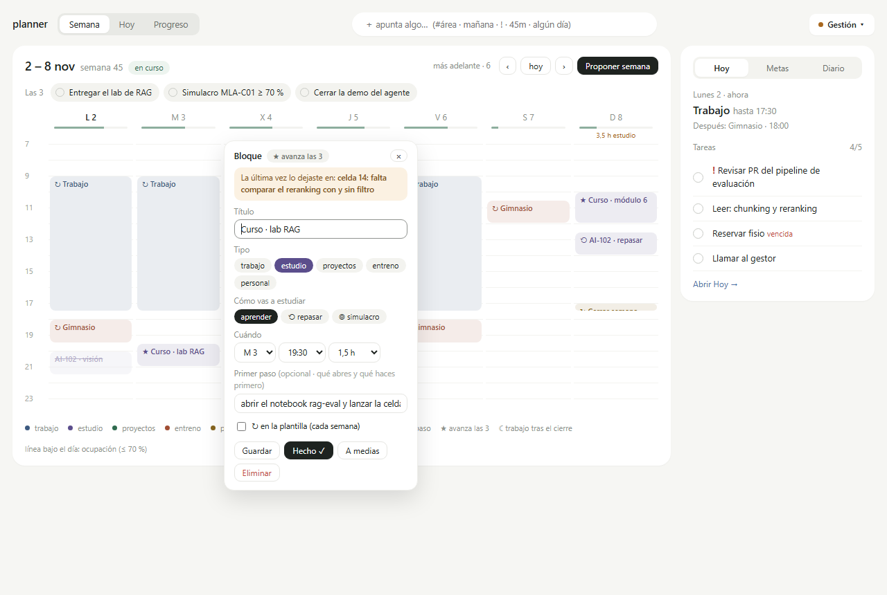
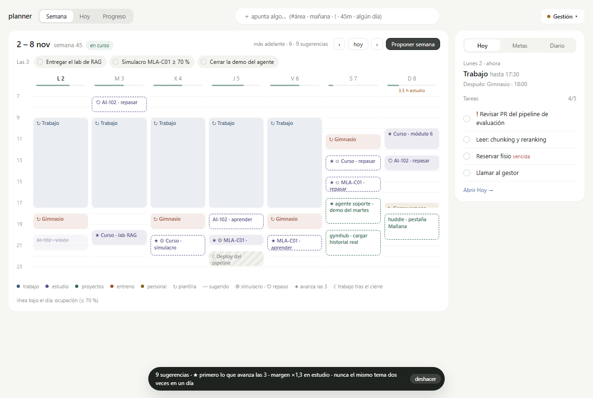
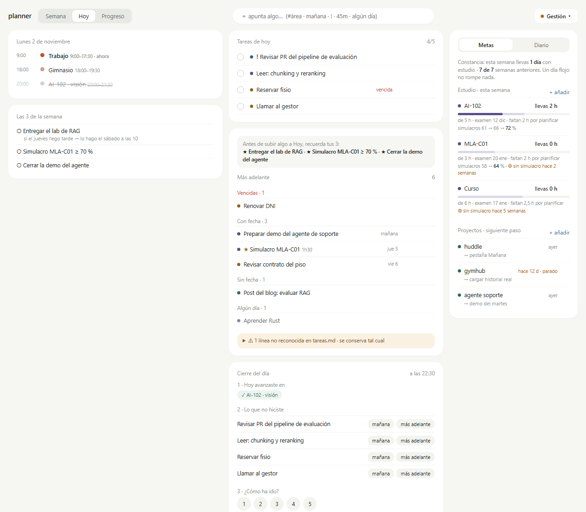
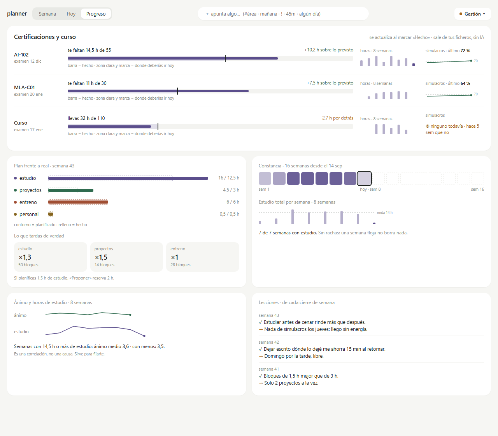
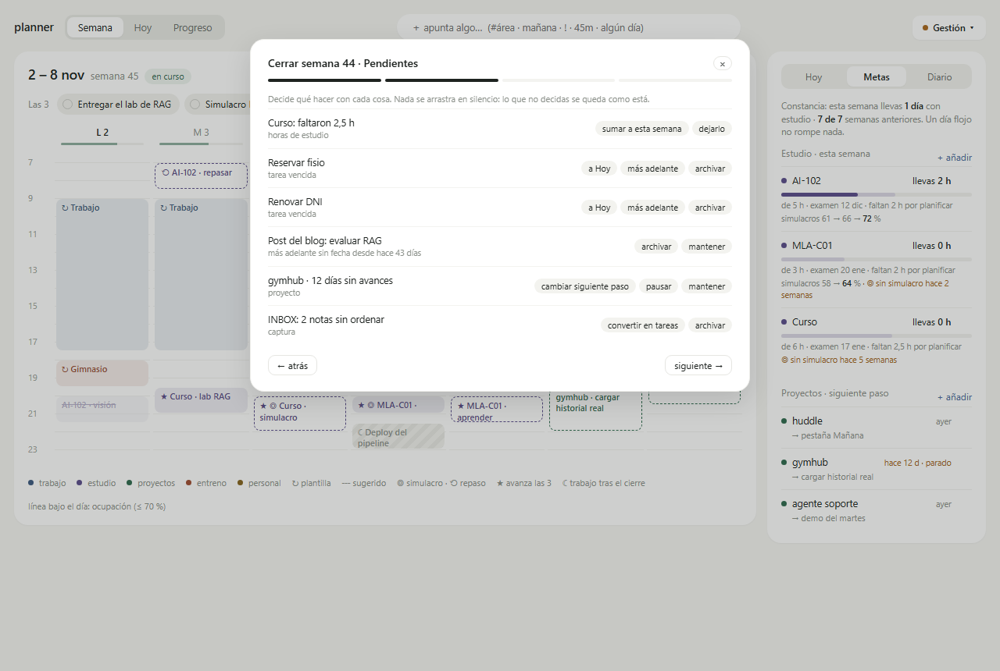
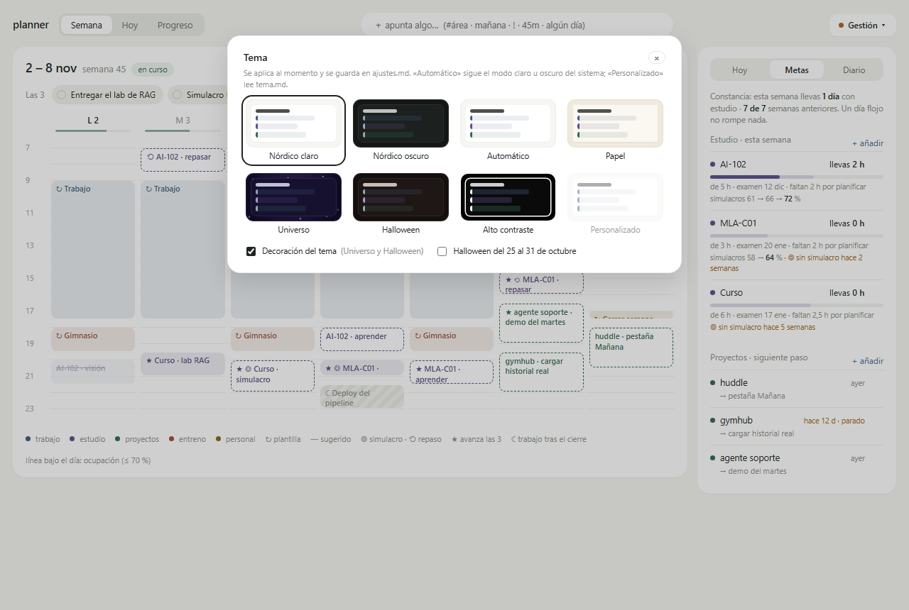
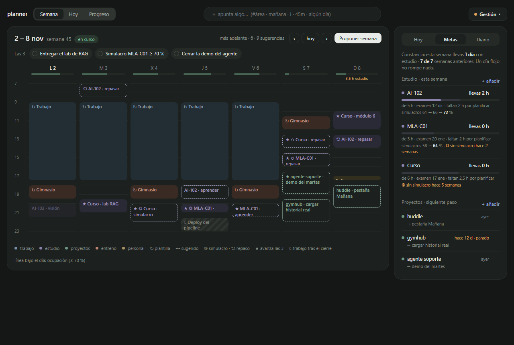

# planner

Organizador personal local y minimalista: calendario semanal por horas, vista Hoy, metas de estudio y proyectos, cierres del día y de la semana, y una pestaña de progreso. Varios temas: claro, oscuro, papel, universo violeta, Halloween y alto contraste. Todo se guarda en ficheros Markdown en tu carpeta. Sin IA para usarlo, sin nube y sin dependencias.

Especificación en [`docs/PLAN.md`](docs/PLAN.md) · diseño técnico (gramática de los ficheros, operaciones, riesgos) en [`docs/DISENO.md`](docs/DISENO.md) · maqueta en [`docs/maquetas/planner-nordico.html`](docs/maquetas/planner-nordico.html).

## Capturas

Con los datos inventados de [`ejemplo/`](ejemplo/) (`planner --ejemplo --hoy 2026-11-02`).

| | |
|---|---|
|  |  |
| **Semana**: bloques por horas, carriles, ocupación del día, Las 3 y ★ | **Editor**: tipo, subtipo de estudio, primer paso, «Hecho ✓» y «A medias» |
|  |  |
| **Proponer semana**: sugerencias discontinuas, sin solapes, con deshacer | **Hoy**: horario, tareas, más adelante por grupos y cierre del día |
|  |  |
| **Progreso**: certificaciones, plan frente a real, constancia, ánimo y lecciones | **Cerrar semana**: pendientes con una decisión cada uno |
|  |  |
| **Temas**: seis temas, automático y personalizado | **Nórdico oscuro** |

## Instalación (WSL o Linux)

Requisitos: Node ≥ 20 y pnpm. Paso a paso, desde cero, en [`instrucciones.md`](instrucciones.md).

```bash
pnpm setup                               # una vez: carpeta global de pnpm (abre otra terminal después)
pnpm install
pnpm add -g /mnt/d/GitHub/planner        # deja el comando `planner` disponible (enlazado al repo)
```

## Uso

```bash
planner                          # arranca en http://localhost:4321 y abre el navegador
planner --datos /mnt/d/planner   # otra carpeta de datos (también: PLANNER_DATOS=…)
planner --puerto 5000            # otro puerto (si está ocupado, usa el siguiente libre)
planner --silencioso             # sin abrir el navegador
planner status                   # ¿está en marcha? puerto, carpeta y PID
planner stop                     # lo para
planner --ejemplo                # prueba con una copia temporal de ejemplo/ (no toca tus datos)
planner --ejemplo --hoy 2026-11-02   # el escenario de la maqueta
```

La carpeta por defecto es `D:\planner` (`/mnt/d/planner` en WSL). Si no existe o está vacía, la primera pantalla es una guía de 3 pasos que la crea: semana tipo, estudio y proyectos, y «Proponer mi primera semana». Una segunda instancia no arranca otro servidor: abre la pestaña de la primera.

### Como app con su propia ventana

En Edge o Chrome, con planner abierto: **⋯ → Aplicaciones → Instalar planner**. Queda en el menú Inicio y abre en su propia ventana. (`localhost` cuenta como origen seguro; no hace falta service worker.)

### Arranque con Windows

Copia [`scripts/windows/planner-inicio.vbs`](scripts/windows/) a la carpeta `shell:startup`. Instrucciones en [`scripts/windows/LEEME.md`](scripts/windows/LEEME.md).

## Cómo se usa

| Vista | Para qué |
|---|---|
| **Semana** | Doble clic en un hueco crea un bloque de 1 h; arrastra para mover (ajuste a 30 min y a otro día); estira el borde inferior; clic para editar (título, tipo, ◎ simulacro / ⟲ repaso, primer paso, ↻ plantilla). **Hecho ✓** pregunta cuánto duró de verdad; **A medias** guarda dónde lo dejaste. **Proponer semana** coloca tus horas de estudio y proyectos sin solapar. |
| **Hoy** | Horario del día, Las 3, tareas de hoy (máx. configurable) y más adelante por grupos; **cierre del día** en 4 pasos que termina en «mañana empiezo por…». |
| **Progreso** | Certificaciones (bullet graph), plan frente a real, lo que tardas de verdad, constancia sin rachas, ánimo y horas, lecciones. |
| **Gestión ▾** | Semanas (−4…+5), Cerrar semana (asistente de 4 pasos), Plantilla, Tipos, Tema y Ajustes. |

**Apunta algo** (barra superior): `#área` (prefijo de un tipo), `hoy | mañana | lun…dom | dd/mm`, `!` prioridad, `45m | 2h | 1h30`, `algún día`. Enter guarda.

Teclado: `Esc` cierra popovers, modales y menús; `Enter` abre el bloque con foco y guarda formularios.

## Tus datos

Una carpeta de Markdown legible y editable a mano: `ajustes.md`, `tipos.md`, `plantilla.md`, `tareas.md`, `estudio.md`, `proyectos.md`, `inbox.md`, `tema.md` (opcional), `semanas/AAAA-Www.md`, `diario/AAAA-MM-DD.md` y `archivo/`. La gramática exacta está en [`docs/DISENO.md`](docs/DISENO.md).

- Escritura atómica (temporal → fsync → rename) y copia diaria en `.copias/AAAA-MM-DD/` (se guardan 14). Alternativas en Ajustes: al cerrar semana o git local (un commit por cierre de día, nunca remoto).
- Lo que el planner no entiende se conserva tal cual y se marca con «⚠ línea no reconocida».
- Si editas un fichero a mano con planner abierto, lo recarga en 2 s; si además tenías un cambio en vuelo, avisa y recarga.
- Cada cambio se puede deshacer durante 10 s desde el aviso.
- El repo nunca contiene datos reales: solo [`ejemplo/`](ejemplo/) con datos inventados.

### Tema personalizado

Crea `tema.md` en tu carpeta, elige **Personalizado** en Gestión → Tema:

```markdown
- base: nordico-oscuro
- acento: #E0A25A
- fondo: #101312
```

Tokens: `fondo`, `superficie`, `superficie-2`, `texto`, `texto-2`, `texto-3`, `borde`, `acento`, `acento-texto`, `aviso`, `aviso-fondo`, `ok`, `ok-fondo`, `peligro`, `sombra`, `sombra-alta`, `radio`, `fuente`, `fondo-deco`, `enlace`. Si el texto queda con poco contraste, Ajustes lo avisa (pero lo respeta).

## Plugin de Claude Code (opcional)

planner no usa IA. Si quieres, [`plugin/`](plugin/) añade a Claude Code `/planner:ordenar` (inbox → tareas), `/planner:repaso` (4–8 semanas → nota en la semana), `/planner:plan-estudio` (temario + examen → `estudio.md`) y `/planner:dividir` (tarea grande → pasos de menos de 2 h). Siempre con vista previa, confirmación y copia en `.copias/` antes de escribir; nunca tocan semanas cerradas ni el diario. Instrucciones en [`plugin/LEEME.md`](plugin/LEEME.md).

## Desarrollo

```bash
pnpm dev      # servidor con una copia temporal de ejemplo/ y reinicio al cambiar src/ o bin/
pnpm test     # node --test (formatos, operaciones e inversas, proponer, cierres, métricas, servidor, CLI, contraste AA)
pnpm check    # sintaxis de todo, core puro, sin colores fijos fuera de web/temas/, sin dependencias
node scripts/iconos.js   # regenera los PNG del icono
```

Arquitectura: `src/core/` es puro e isomórfico (lo usan el servidor y el navegador, servido en `/core/`); `src/server/` lee y escribe la carpeta; `web/` es HTML + CSS + módulos ES sin framework ni build. Rama de trabajo `develop`, un commit por fase.
